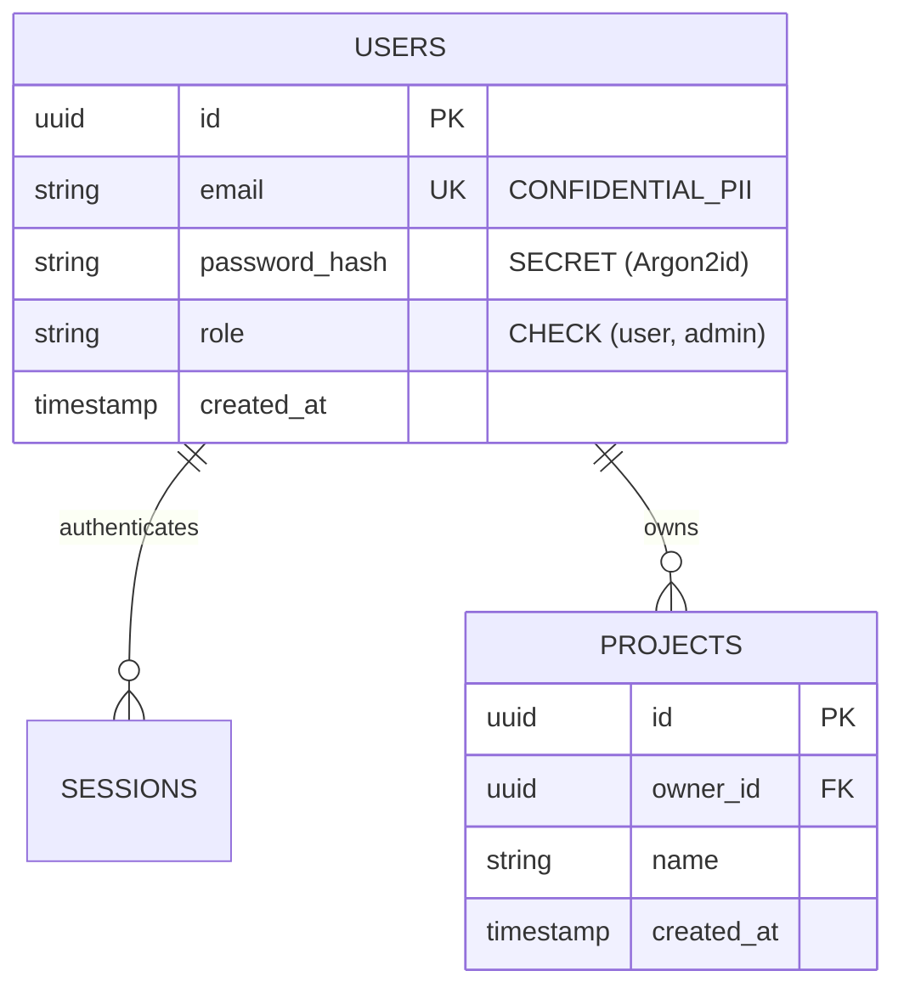

# Database Schema & Data Security Specification (`DB_SCHEMA.md`)

## 1. Storage Engine & ORM/Migration Strategy
- **Database Engine**: `<e.g., PostgreSQL 16 / SQLite 3>`
- **Query Layer / Migration Tool**: `<e.g., Drizzle / Prisma / Alembic / SQL migrations>`
- **Multi-Tenancy & Isolation Strategy**: `<Single-tenant / Tenant column + RLS / Schema-per-tenant>`

## 2. Entity-Relationship Diagram (Mermaid)

## 3. Detailed Table Specifications & Constraints

### Table: `<table_name>`
| Column | Type | Nullable | Default | Constraints | Sensitivity | Description |
| :--- | :--- | :--- | :--- | :--- | :--- | :--- |
| `id` | `UUID` | ` NO` | `gen_random_uuid()` | `PRIMARY KEY` | `PUBLIC` | Non-enumerable identifier |
| `created_at` | `TIMESTAMPTZ` | `NO` | `NOW()` | | `INTERNAL` | Creation timestamp (UTC) |

## 4. Indexing Strategy & Query Access Patterns
| Index Name | Table & Columns | Type | Target Query Pattern |
| :--- | :--- | :--- | :--- |
| `idx_...` | `table(col1, col2)` | `BTREE / UNIQUE` | Fast lookup by ... |

## 5. Data Security, Privacy & Retention Controls
- **Parameterized Queries Rule**: 100% of queries must use bound parameters; raw string interpolation in SQL is strictly prohibited.
- **PII & Secret Handling**:
- **Row-Level Security (RLS) / Ownership Filtering**:
- **Data Retention & Deletion (GDPR / Right to Erasure)**:
- **Backup & Recovery Strategy**:
