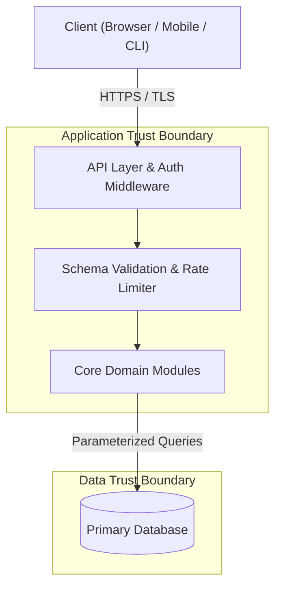

# System Architecture & Module Design (`ARCHITECTURE.md`)

## 1. Architecture Overview & Guiding Principles
- **Architectural Style**: `<e.g., Modular Monolith / Clean Architecture / CLI / Service-Oriented>`
- **Active Bottega Profile**: `spark` | `forge` | `citadel`
- **Key Design Principles**: `<Simplicity, Secure-by-Default, Explicit Boundaries>`

## 2. Technology Stack & Trade-off Decisions
| Layer | Selected Technology | Alternatives Considered | Why Selected (Trade-offs & Security) |
| :--- | :--- | :--- | :--- |
| **Runtime & Language** | | | |
| **Backend Framework** | | | |
| **Frontend / Client** | | | |
| **Database & ORM/Query** | | | |
| **Authentication / AuthZ** | | | |
| **Testing Stack** | | | |

## 3. System Component & Trust Boundary Diagram


## 4. Software Modules & Directory Structure
Define the exact repository layout and module dependency rules:
```text
src/
├── config/       # Validated environment config (fail-fast on startup)
├── modules/      # Domain modules (controllers, services, repositories, schemas)
├── middleware/   # AuthN, AuthZ, error handling, security headers, rate limiting
└── shared/       # Pure utilities, logger (with secret/PII redaction), types
```

| Module Name | Responsibility | Public Interface | Allowed Dependencies |
| :--- | :--- | :--- | :--- |
| | | | |

## 5. API Contracts & Key Workflows
| Endpoint / Operation | Auth Required | Request Schema & Validation | Response & Error Codes | Rate Limit |
| :--- | :--- | :--- | :--- | :--- |
| | | | | |

## 6. Security Architecture Baseline (Shift-Left)
- **Authentication**:
- **Authorization (RBAC / Ownership Checks)**:
- **Input Validation & Output Encoding**:
- **Secrets Management**:
- **HTTP Security Headers & CORS Policy**:
- **Error Handling & Audit Logging (Zero Stack-Trace Leak)**:
